《薩爾達傳說 時之笛》這五個支線，照這篇的順序解就對了：**大鼓隆之劍**（EP.6→EP.12）、**真實面具**（EP.3→EP.11）、**金色鱗片**（EP.12）、**火箭**（EP.13）、**冰箭**（EP.12→EP.14）。下面把每一段的影片連結、時間軸與截圖都整理在一起，想直接看某個任務，點目錄跳過去就好。

## 📋 五個支線快速總表

| 支線任務 | 獎勵 | 主要集數 | 關鍵時間軸 |
|:---|:---|:---|:---|
| 大鼓隆之劍 | 攻擊力最高的大劍 | EP.6、EP.7、EP.8、EP.12 | EP.6 [`54:19`](https://youtu.be/gnmOAUkfDhc?t=3259)、[`1:04:06`](https://youtu.be/gnmOAUkfDhc?t=3846)；EP.7 [`3:52`](https://youtu.be/gTnqeNU90LY?t=232)、[`6:22`](https://youtu.be/gTnqeNU90LY?t=382)、[`12:20`](https://youtu.be/gTnqeNU90LY?t=740)；EP.8 [`45:21`](https://youtu.be/NX1sqqGE42U?t=2721)；EP.12 [`19:23`](https://youtu.be/q4pwnEAHOr4?t=1163) |
| 真實面具 | 可讀取希卡石提示 | EP.3、EP.4、EP.8、EP.10、EP.11 | EP.3 [`57:28`](https://youtu.be/bg2CjpJnpVk?t=3448)；EP.4 [`8:38`](https://youtu.be/Wnb1COZhMCA?t=518)、[`16:26`](https://youtu.be/Wnb1COZhMCA?t=986)；EP.11 [`10:59`](https://youtu.be/cpXj4Oxe3QU?t=659) |
| 金色鱗片 | 潛水深度提升 | EP.12 | EP.12 [`28:08`](https://youtu.be/q4pwnEAHOr4?t=1688) |
| 火箭 | 火屬性箭矢 | EP.13 | EP.13 [`59:29`](https://youtu.be/ypMZWsZdiHM?t=3569) |
| 冰箭 | 冰屬性箭矢 | EP.12、EP.14 | EP.12 [`1:07:08`](https://youtu.be/q4pwnEAHOr4?t=4028)、[`1:23:25`](https://youtu.be/q4pwnEAHOr4?t=5005)、[`1:52:59`](https://youtu.be/q4pwnEAHOr4?t=6779)；EP.14 [`1:34:52`](https://youtu.be/oHmuer22F6o?t=5692)、[`1:39:14`](https://youtu.be/oHmuer22F6o?t=5954) |

> 這篇是以宅爸的直播說明欄為主要依據，加上實際影片時間軸整理。遊戲版本為《薩爾達傳說 時之笛》重製版直播；不同版本的操作位置可能略有差異。本文含後期支線與道具劇透，請斟酌閱讀。
{: .prompt-info }

### 直接跳看（YouTube 時間軸連結）

- 大鼓隆之劍：EP.12 [`19:23`](https://youtu.be/q4pwnEAHOr4?t=1163) 取得｜<https://youtu.be/q4pwnEAHOr4?t=1163>
- 真實面具：EP.11 [`10:59`](https://youtu.be/cpXj4Oxe3QU?t=659) 取得｜<https://youtu.be/cpXj4Oxe3QU?t=659>
- 金色鱗片：EP.12 [`28:08`](https://youtu.be/q4pwnEAHOr4?t=1688) 取得｜<https://youtu.be/q4pwnEAHOr4?t=1688>
- 火箭：EP.13 [`59:29`](https://youtu.be/ypMZWsZdiHM?t=3569) 取得｜<https://youtu.be/ypMZWsZdiHM?t=3569>
- 冰箭：EP.14 [`1:39:14`](https://youtu.be/oHmuer22F6o?t=5954) 取得｜<https://youtu.be/oHmuer22F6o?t=5954>

---

## ⚔️ 大鼓隆之劍怎麼拿？從咕咕雞蛋開始的跨集任務

大鼓隆之劍是《時之笛》攻擊力最高的大劍，但流程橫跨 EP.6～EP.12，而且中間有好幾段限時送貨。**先把前置「袖珍咕咕雞的雞蛋 → 小雞郎 → 迷途森林木匠哥哥 → 蘑菇 → 萬能藥 → 法德」做完，再接 EP.8 的盜獵者鋸子與 EP.12 的斷劍修復。**

### 大鼓隆之劍完整步驟

| 步驟 | 影片 | 時間軸 | 做什麼 |
|:---:|:---|:---|:---|
| 1 | EP.6 | [`54:19`](https://youtu.be/gnmOAUkfDhc?t=3259) | 獲得袖珍咕咕雞的雞蛋（任務起點） |
| 2 | EP.6 | [`1:04:06`](https://youtu.be/gnmOAUkfDhc?t=3846) | 吵醒榮恩，獲得小雞郎 |
| 3 | EP.7 | [`3:52`](https://youtu.be/gTnqeNU90LY?t=232) | 拿小雞郎給在迷途森林的木匠哥哥 |
| 4 | EP.7 | [`6:22`](https://youtu.be/gTnqeNU90LY?t=382) | 把蘑菇給卡卡利科村的老婆婆，換得萬能藥 |
| 5 | EP.7 | [`12:20`](https://youtu.be/gTnqeNU90LY?t=740) | 把萬能藥給迷途森林的法德，換得盜獵者鋸子 |
| 6 | EP.8 | [`45:21`](https://youtu.be/NX1sqqGE42U?t=2721) | 盜獵者鋸子給老婆婆看 |
| 7 | EP.12 | [`3:45`](https://youtu.be/q4pwnEAHOr4?t=225) | 把鋸子拿給木匠師傅 |
| 8 | EP.12 | [`6:03`](https://youtu.be/q4pwnEAHOr4?t=363) | 把斷劍拿到死亡之山頂 |
| 9 | EP.12 | [`10:36`](https://youtu.be/q4pwnEAHOr4?t=636) | 跟卓拉王拿藥材，限時送到湖畔研究所 |
| 10 | EP.12 | [`13:21`](https://youtu.be/q4pwnEAHOr4?t=801) | 跟博士拿眼藥水，限時送到山頂 |
| 11 | EP.12 | [`17:10`](https://youtu.be/q4pwnEAHOr4?t=1030) | 眼藥水給大鼓隆，三天後領劍 |
| 12 | EP.12 | [`19:23`](https://youtu.be/q4pwnEAHOr4?t=1163) | 吹奏太陽之歌，讓時間快轉三天，入手大鼓隆之劍 |

<!-- -->
> **重點提醒**：這條任務線上有好幾段限時運送。EP.7 的「蘑菇 → 萬能藥」與 EP.12 的「卓拉王 → 湖畔研究所」、「博士 → 死亡之山頂」都有時間限制，**運送途中不能使用傳送**，只能靠最短路線（可以騎伊波娜）親自跑過去；失敗可以重接。
{: .prompt-warning }

> **流程補充**：EP.7 的順序是「木匠哥哥 → 蘑菇 → 卡卡利科村藥水店老婆婆 → 萬能藥 → 迷途森林法德」。老婆婆做好藥時會說「這是說好的萬能藥，麻煩你把它交給我兒子」，所以拿到萬能藥後要馬上送回迷途森林，不要在中途閒逛。
{: .prompt-info }

### 影片截圖

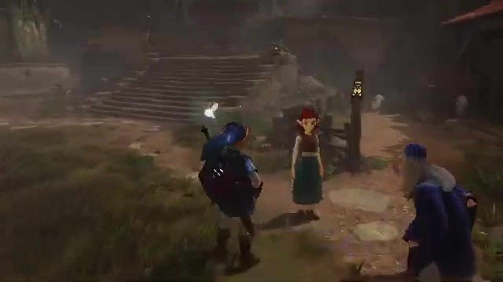{: .normal}
_EP.6 [`54:19`](https://youtu.be/gnmOAUkfDhc?t=3259)：取得袖珍咕咕雞的雞蛋，這是大鼓隆之劍前置的第一步。_

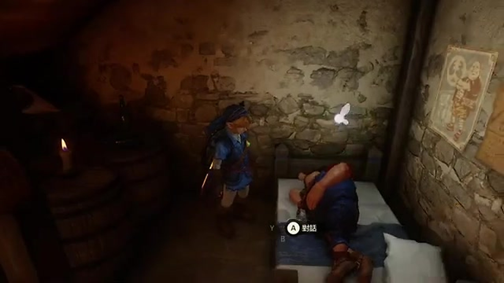{: .normal}
_EP.6 [`1:04:06`](https://youtu.be/gnmOAUkfDhc?t=3846)：吵醒榮恩，取得小雞郎。_

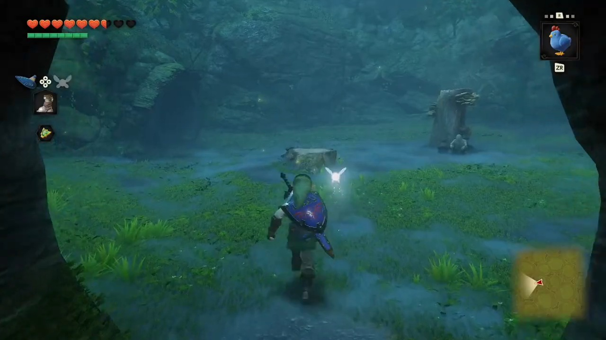{: .normal}
_EP.7 [`3:52`](https://youtu.be/gTnqeNU90LY?t=232)：把小火雞交給在迷途森林的木匠哥哥。_

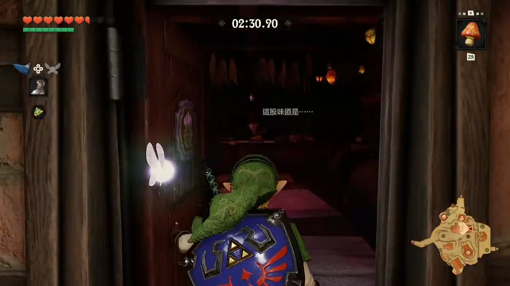{: .normal}
_EP.7 [`6:22`](https://youtu.be/gTnqeNU90LY?t=382)：把蘑菇交給卡卡利科村的老婆婆；她會唸「古怪氣味是從你那兒傳來的」，接著就幫你做萬能藥。_

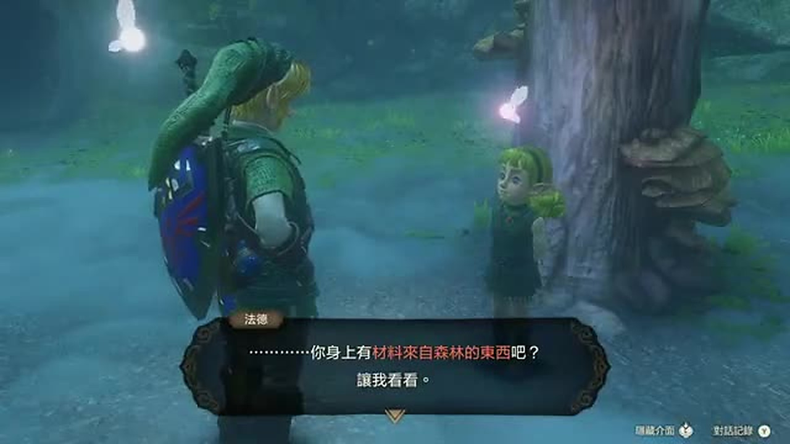{: .normal}
_EP.7 [`12:20`](https://youtu.be/gTnqeNU90LY?t=740)：把萬能藥交給迷途森林的法德，對話會提到「你身上有材料來自森林的東西吧」，交出去後換得盜獵者鋸子。_

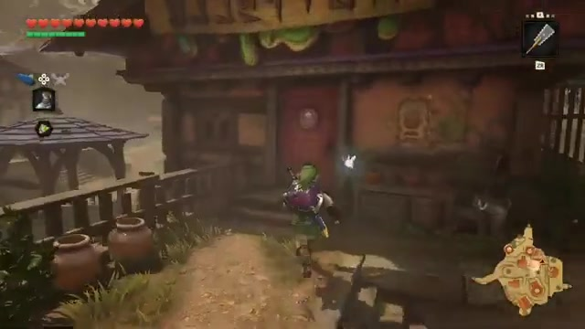{: .normal}
_EP.8 [`45:21`](https://youtu.be/NX1sqqGE42U?t=2721)：盜獵者鋸子相關進度，為 EP.12 把鋸子交給木匠師傅鋪路。_

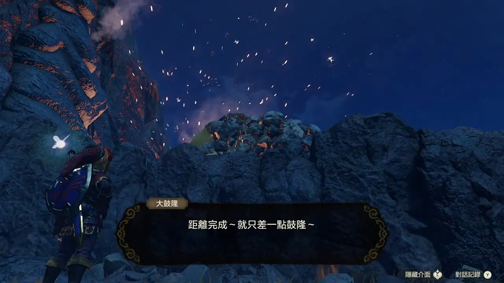{: .normal}
_EP.12 [`19:23`](https://youtu.be/q4pwnEAHOr4?t=1163)：吹奏太陽之歌快轉三天後，正式取得大鼓隆之劍。_

### 大鼓隆之劍影片連結

- EP.6：<https://www.youtube.com/watch?v=gnmOAUkfDhc>
- EP.7：<https://www.youtube.com/watch?v=gTnqeNU90LY>
- EP.8：<https://www.youtube.com/watch?v=NX1sqqGE42U>
- EP.12：<https://www.youtube.com/watch?v=q4pwnEAHOr4>

---

## 🎭 真實面具怎麼拿？面具交換任務的完整順序

真實面具（Mask of Truth）可以讀取八卦石（Gossip Stone）的提示，是解謎與收集的好幫手。**任務從 EP.3 卡卡利科村的警衛開始，依序把奇坦面具、骷髏面具、恐怖面具、兔子面具交出去，最後回面具店找商人即可取得真實面具。**

### 面具交換任務完整步驟

| 步驟 | 影片 | 時間軸 | 做什麼 |
|:---:|:---|:---|:---|
| 1 | EP.3 | [`57:28`](https://youtu.be/bg2CjpJnpVk?t=3448) | 卡卡利科村的警衛：面具任務起始 |
| 2 | EP.4 | [`8:38`](https://youtu.be/Wnb1COZhMCA?t=518) | 借用奇坦面具解任務 |
| 3 | EP.4 | [`16:26`](https://youtu.be/Wnb1COZhMCA?t=986) | 拿面具給卡卡利科村警衛 |
| 4 | EP.8 | [`51:07`](https://youtu.be/NX1sqqGE42U?t=3067) | 回報面具任務、買新面具 |
| 5 | EP.10 | [`0:00`](https://youtu.be/DLk_vaVqfa4?t=0) | 拿骷髏面具給骷髏小子 |
| 6 | EP.11 | [`3:40`](https://youtu.be/cpXj4Oxe3QU?t=220) | 恐怖面具要給墓園小孩 |
| 7 | EP.11 | [`9:29`](https://youtu.be/cpXj4Oxe3QU?t=569) | 兔子面具要給馬拉松人 |
| 8 | EP.11 | [`10:59`](https://youtu.be/cpXj4Oxe3QU?t=659) | 解鎖所有面具，獲得真實面具 |

<!-- -->
> **補充**：EP.11 [`33:08`](https://youtu.be/cpXj4Oxe3QU?t=1988) 宅爸有嘗試「帶面具騙過格魯德警衛」，但沒有成功；這是額外嘗試，不是取得真實面具的必要步驟。
{: .prompt-info }

### 影片截圖

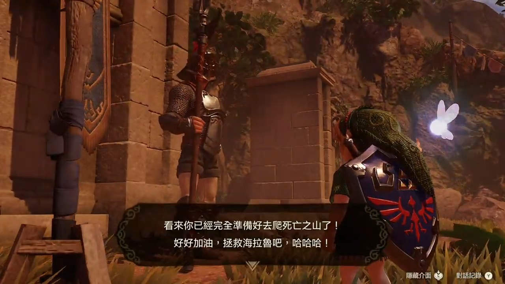{: .normal}
_EP.3 [`57:28`](https://youtu.be/bg2CjpJnpVk?t=3448)：在卡卡利科村與警衛對話，開啟面具任務線。_

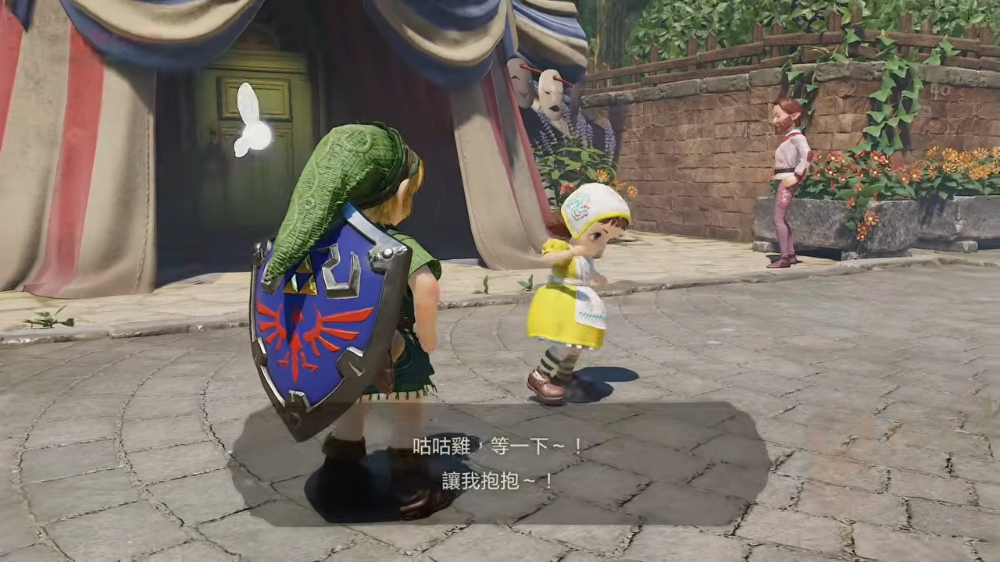{: .normal}
_EP.4 [`8:38`](https://youtu.be/Wnb1COZhMCA?t=518)：借用奇坦面具，準備交給指定 NPC。_

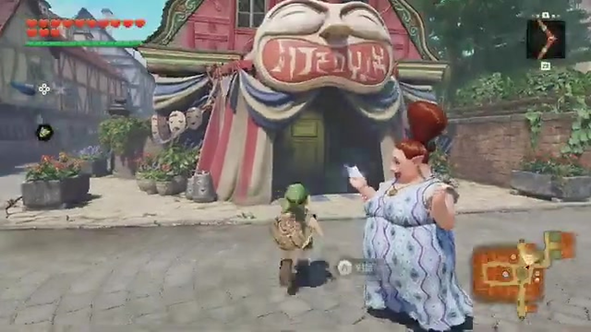{: .normal}
_EP.11 [`10:59`](https://youtu.be/cpXj4Oxe3QU?t=659)：所有面具解鎖後，取得真實面具。_

### 真實面具影片連結

- EP.3：<https://www.youtube.com/watch?v=bg2CjpJnpVk>
- EP.4：<https://www.youtube.com/watch?v=Wnb1COZhMCA>
- EP.8：<https://www.youtube.com/watch?v=NX1sqqGE42U>
- EP.10：<https://www.youtube.com/watch?v=DLk_vaVqfa4>
- EP.11：<https://www.youtube.com/watch?v=cpXj4Oxe3QU>

---

## 🐟 金色鱗片怎麼拿？釣魚池 60cm 的門檻

金色鱗片（Golden Scale）讓林克可以潛得更深，是拿心之碎片與探索湖底的重要道具。**在 EP.12 的釣魚池釣到 62cm 的魚後取得；EP.4 的 55cm 尚未達標。**

### 金色鱗片取得時間軸

| 影片 | 時間軸 | 內容 |
|:---|:---|:---|
| EP.4 | [`55:04`](https://youtu.be/Wnb1COZhMCA?t=3304) | 釣到 55cm 的魚（尚未取得金色鱗片） |
| EP.12 | [`21:41`](https://youtu.be/q4pwnEAHOr4?t=1301) | 來看釣魚池有什麼好貨 |
| EP.12 | [`28:08`](https://youtu.be/q4pwnEAHOr4?t=1688) | 釣到 62cm 的魚，獲得金色鱗片 |

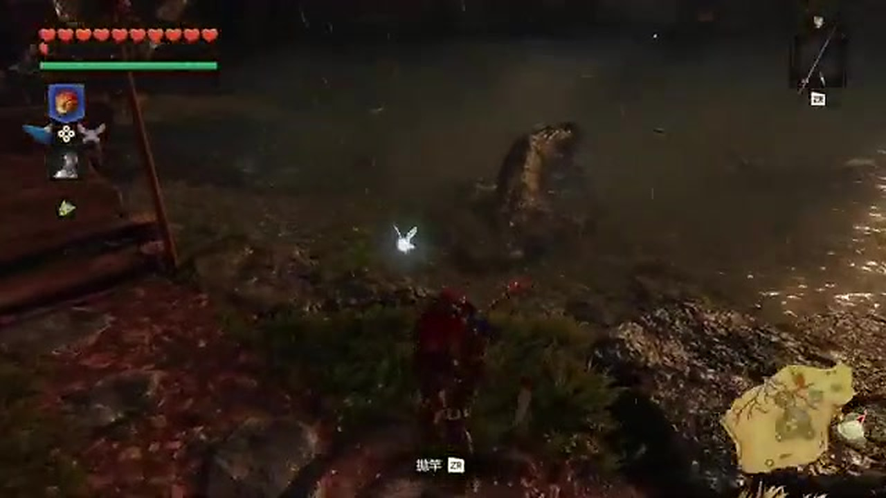{: .normal}
_EP.12 [`28:08`](https://youtu.be/q4pwnEAHOr4?t=1688)：釣到 62cm 的魚，取得金色鱗片。_

> **小提醒**：釣魚時要注意魚的拉力與線的張力，太大隻的魚會一直掙脫。若只想拿金色鱗片，可以鎖定大魚反覆挑戰，釣到 62cm 左右就有機會達標。
{: .prompt-tip }

**影片連結**：<https://www.youtube.com/watch?v=q4pwnEAHOr4>

---

## 🔥 火箭在哪裡拿？水之神殿的隱藏火箭

火箭（Fire Arrow）是後期解謎與戰鬥都很實用的箭種。**EP.13 水之神殿通關後，於 [`59:29`](https://youtu.be/ypMZWsZdiHM?t=3569) 取得隱藏火箭。**

> 應該不需通關水之神殿就能入手，只要在日出時間，把箭射向光環即可

### 火箭取得時間軸

| 影片 | 時間軸 | 內容 |
|:---|:---|:---|
| EP.13 | [`59:29`](https://youtu.be/ypMZWsZdiHM?t=3569) | 運氣超好，剛好可以拿火箭 |

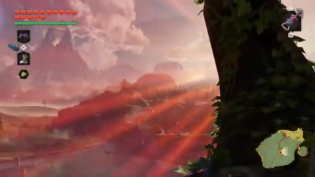{: .normal}
_EP.13 [`59:31`](https://youtu.be/ypMZWsZdiHM?t=3571)：水之神殿通關後，取得隱藏火箭。_

> 說明欄會寫「運氣超好」，是因為時間剛好對上。
{: .prompt-info }

**影片連結**：<https://www.youtube.com/watch?v=ypMZWsZdiHM>

---

## ❄️ 冰箭怎麼拿？格魯德訓練場與隱藏鑰匙

冰箭（Ice Arrow）是格魯德訓練場的全破獎勵。**EP.12 先探索訓練場（Round.1、Round.2、隱藏路線），EP.14 取得最後一把鑰匙後，於 [`1:39:14`](https://youtu.be/oHmuer22F6o?t=5954) 拿到冰箭。**

### 冰箭取得時間軸

| 影片 | 時間軸 | 內容 |
|:---|:---|:---|
| EP.12 | [`1:07:08`](https://youtu.be/q4pwnEAHOr4?t=4028) | 格魯德訓練場 Round.1 |
| EP.12 | [`1:23:25`](https://youtu.be/q4pwnEAHOr4?t=5005) | 格魯德訓練場 Round.2 |
| EP.12 | [`1:52:59`](https://youtu.be/q4pwnEAHOr4?t=6779) | 找到鐵網上的隱藏路線，然後卡關 |
| EP.14 | [`1:34:52`](https://youtu.be/oHmuer22F6o?t=5692) | 取得格魯德訓練場最後一把鑰匙 |
| EP.14 | [`1:39:14`](https://youtu.be/oHmuer22F6o?t=5954) | 取得冰箭 |

<!-- -->
> **重要註記**：如果都開啟左邊的門，不拿大石頭後面的鑰匙也可以拿到冰箭。
{: .prompt-tip }

### 影片截圖

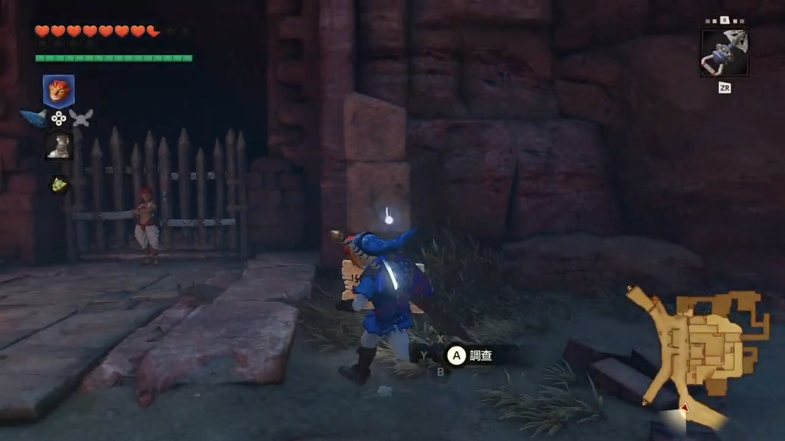{: .normal}
_EP.12 [`1:07:08`](https://youtu.be/q4pwnEAHOr4?t=4028)：格魯德訓練場 Round.1，開始挑戰訓練場。_

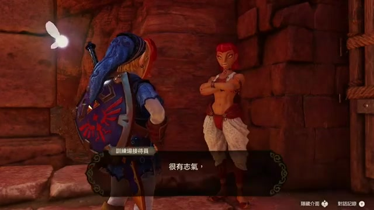{: .normal}
_EP.12 [`1:23:25`](https://youtu.be/q4pwnEAHOr4?t=5005)：格魯德訓練場 Round.2；若左側的門都打開，可以不拿隱藏鑰匙。_

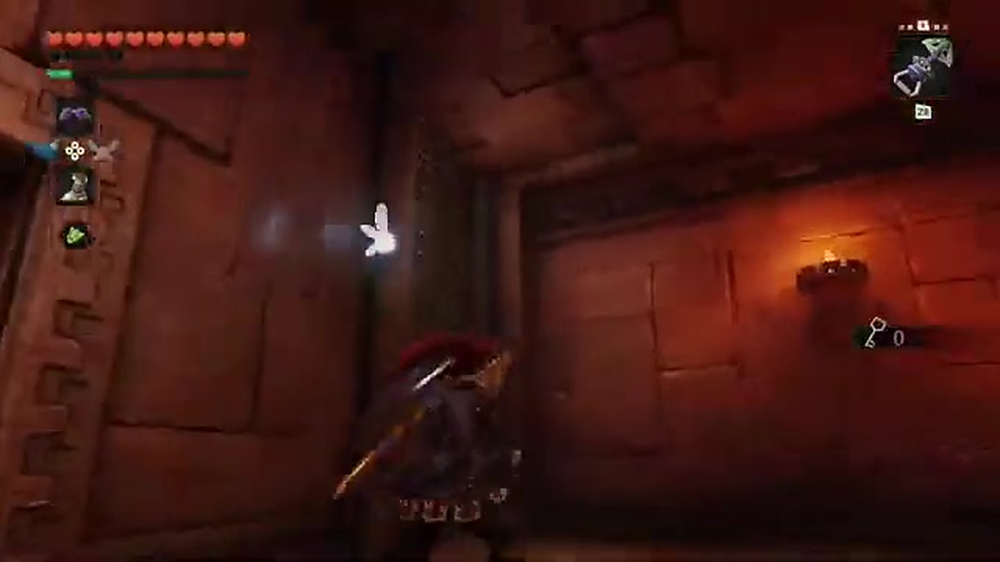{: .normal}
_EP.12 [`1:52:59`](https://youtu.be/q4pwnEAHOr4?t=6779)：找到鐵網上的隱藏路線。_

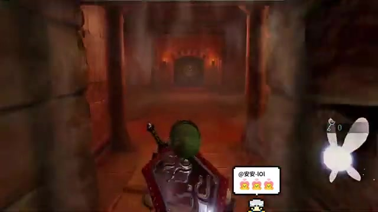{: .normal}
_EP.14 [`1:34:52`](https://youtu.be/oHmuer22F6o?t=5692)：取得格魯德訓練場最後一把鑰匙。_

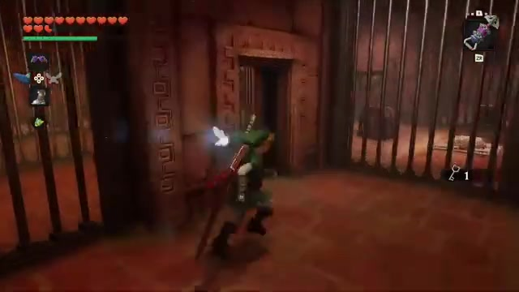{: .normal}
_EP.14 [`1:39:14`](https://youtu.be/oHmuer22F6o?t=5954)：用最後一把鑰匙開門，取得冰箭。_

### 冰箭影片連結

- EP.12：<https://www.youtube.com/watch?v=q4pwnEAHOr4>
- EP.14：<https://www.youtube.com/watch?v=oHmuer22F6o>

---

## 🗺️ 五個支線的建議攻略順序

如果你不想來回跳集，可以照下面的順序跑。EP.12 是支線最密集的一集，建議先把前面幾個前置做完，再一口氣解大鼓隆之劍、金色鱗片與格魯德訓練場。

1. **EP.3 [`57:28`](https://youtu.be/bg2CjpJnpVk?t=3448)**：到卡卡利科村找警衛，開啟面具任務。
2. **EP.6 [`54:19`](https://youtu.be/gnmOAUkfDhc?t=3259)、[`1:04:06`](https://youtu.be/gnmOAUkfDhc?t=3846)**：取得袖珍咕咕雞的雞蛋，吵醒榮恩拿小雞郎。
3. **EP.7 [`3:52`](https://youtu.be/gTnqeNU90LY?t=232)、[`6:22`](https://youtu.be/gTnqeNU90LY?t=382)、[`12:20`](https://youtu.be/gTnqeNU90LY?t=740)**：拿小雞郎給迷途森林的木匠哥哥 → 蘑菇給卡卡利科村老婆婆 → 萬能藥給迷途森林的法德（換得盜獵者鋸子）。
4. **EP.8 [`45:21`](https://youtu.be/NX1sqqGE42U?t=2721)、[`51:07`](https://youtu.be/NX1sqqGE42U?t=3067)**：盜獵者鋸子後續，回報面具任務。
5. **EP.10 [`0:00`](https://youtu.be/DLk_vaVqfa4?t=0)**：拿骷髏面具給骷髏小子。
6. **EP.11 [`3:40`](https://youtu.be/cpXj4Oxe3QU?t=220)、[`9:29`](https://youtu.be/cpXj4Oxe3QU?t=569)、[`10:59`](https://youtu.be/cpXj4Oxe3QU?t=659)**：依序交恐怖面具、兔子面具，取得真實面具。
7. **EP.12 [`3:45`](https://youtu.be/q4pwnEAHOr4?t=225)～[`19:23`](https://youtu.be/q4pwnEAHOr4?t=1163)**：完成大鼓隆之劍；[`21:41`](https://youtu.be/q4pwnEAHOr4?t=1301)～[`28:08`](https://youtu.be/q4pwnEAHOr4?t=1688) 拿金色鱗片；[`1:07:08`](https://youtu.be/q4pwnEAHOr4?t=4028)～[`1:52:59`](https://youtu.be/q4pwnEAHOr4?t=6779) 挑戰格魯德訓練場。
8. **EP.13 [`59:29`](https://youtu.be/ypMZWsZdiHM?t=3569)**：水之神殿通關後拿火箭。
9. **EP.14 [`1:34:52`](https://youtu.be/oHmuer22F6o?t=5692)、[`1:39:14`](https://youtu.be/oHmuer22F6o?t=5954)**：補最後一把鑰匙，取得冰箭。

---

## ❓ 常見問題（FAQ）

### Q1：大鼓隆之劍一定要先拿小雞郎嗎？

是。**大鼓隆之劍的前置是「袖珍咕咕雞的雞蛋 → 小雞郎 → 迷途森林木匠哥哥 → 蘑菇 → 萬能藥 → 法德」**，沒有前面的小雞郎就換不到蘑菇，也就接不到後面的鋸子與斷劍流程。

### Q2：真實面具可以跳過哪個面具？

不行跳過。**奇坦面具、骷髏面具、恐怖面具、兔子面具都要依序交出去**，全部完成後回面具店，才會拿到真實面具。

### Q3：金色鱗片 55cm 為什麼沒拿到？

依直播說明欄，EP.4 的 55cm 尚未取得金色鱗片；**EP.12 釣到 62cm 的魚才拿到**。實際獎勵判定請以遊戲內釣魚池的提示為準。

### Q4：冰箭一定要拿隱藏鑰匙嗎？

不一定。**如果都開啟左邊的門，不拿隱藏鑰匙也可以拿到冰箭。** EP.12 的隱藏路線是其中一種走法，卡關時可以先檢查左側的門是否全開。

---

## 📺 直播播放清單與各集連結

- 播放清單：<https://www.youtube.com/playlist?list=PLN9g1rvyo05pff0Mv6C-xdDxCNRjdomWh>
- EP.3：<https://www.youtube.com/watch?v=bg2CjpJnpVk>
- EP.4：<https://www.youtube.com/watch?v=Wnb1COZhMCA>
- EP.6：<https://www.youtube.com/watch?v=gnmOAUkfDhc>
- EP.7：<https://www.youtube.com/watch?v=gTnqeNU90LY>
- EP.8：<https://www.youtube.com/watch?v=NX1sqqGE42U>
- EP.10：<https://www.youtube.com/watch?v=DLk_vaVqfa4>
- EP.11：<https://www.youtube.com/watch?v=cpXj4Oxe3QU>
- EP.12：<https://www.youtube.com/watch?v=q4pwnEAHOr4>
- EP.13：<https://www.youtube.com/watch?v=ypMZWsZdiHM>
- EP.14：<https://www.youtube.com/watch?v=oHmuer22F6o>

---

這篇把五個支線的影片時間軸與截圖整理在一起，之後如果要補其他任務，也可以沿用同樣的格式。若你正在玩重製版，建議先把「大鼓隆之劍」與「真實面具」解完，這兩樣對後期探索的幫助最大。祝你在海拉魯玩得開心！

更多電玩相關文章：<https://vanix.github.io/categories/%E9%9B%BB%E7%8E%A9/>
